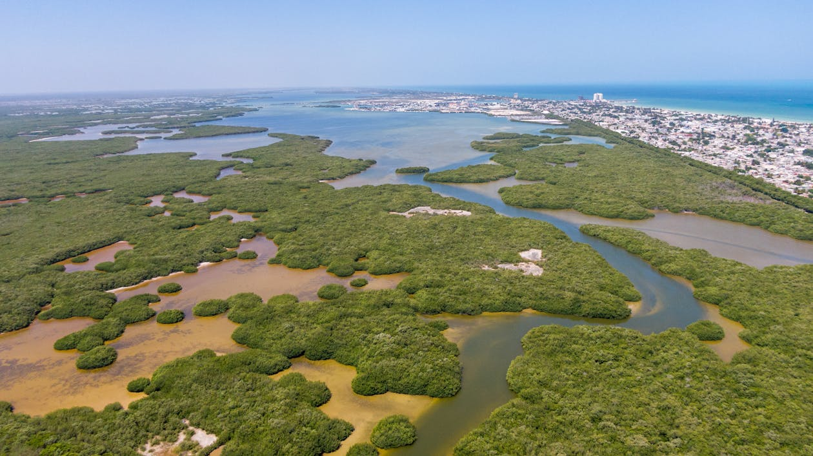
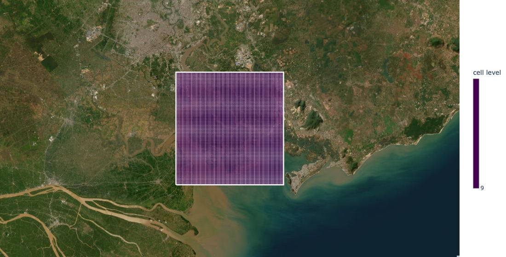
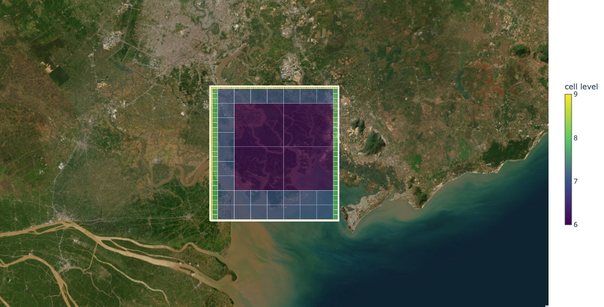

# KindGrove

*Mangrove biomass and carbon from Sentinel-2: an open-science workflow for the OGC Open Science Persistent Demonstrator.*


*Mangrove forest, Progreso, Mexico. Photo by Carlos Canche Uc, [Pexels](https://www.pexels.com/photo/aerial-view-of-mangrove-forest-in-progreso-mexico-29860697/).*

KindGrove estimates mangrove above-ground biomass and carbon from Sentinel-2 imagery: NDVI
classification, a field-validated allometric model, four dates per site to watch change. It was
delivered to the OGC Open Science Persistent Demonstrator in 2025 as an OGC Application Package
and is one of the workflows the OSPD 2026 call names as ready to profile.

## Running it

```bash
uv sync
uv run python scripts/prime_cache.py "Sundarbans"
uv run marimo run fingerprints_marimo.py
```

The full guide, including the application package and the tests, is [docs/USAGE.md](docs/USAGE.md).
Prerequisites: uv, a Rust toolchain, `burin-core` checked out next to this repository, and for
the package Docker and cwltool.

## The workflow

Sentinel-2 L2A from the AWS Open Data Registry through STAC, no authentication. Scenes are ranked
by how much of the study area their footprint covers, then by cloud. Mangrove is NDVI between
0.4 and 0.95; biomass is 250.5 × NDVI − 75.2 Mg/ha (Myanmar field plots, R² 0.72); carbon is 47 %
of biomass. Sites: Sundarbans, Can Gio Biosphere Reserve, Thor Heyerdahl Climate Park, Wunbaik
Reserved Forest. Uncertainty about ±30 %, suitable for demonstration and preliminary assessment,
not for carbon certification.

Method, results, and what the fingerprints found in last year's numbers: [FINDINGS.md](FINDINGS.md).
The application package and its images: [docs/CWL_README.md](docs/CWL_README.md).

## Fingerprints

Every entity in the workflow's provenance chain now carries a **fingerprint**: the identity of
the ground it covers, computed on the OGC-registered rHEALPix grid in OGC API - DGGS terms. Same
ground in any encoding, one root; two platforms, same root; set algebra with exact areas. The
scene, the analysis output and the mangrove mask each carry one.

| every zone | rolled up to the compact form, same root |
|---|---|
|  |  |

The one-page version for the OSPD 2026 group: [docs/FINGERPRINTS.md](docs/FINGERPRINTS.md).
Behind it: the STAC extension ([stac-extension/](stac-extension/)), one run as a provenance chain
([docs/examples/provenance.json](docs/examples/provenance.json)), the CWL step (`cwl/`), and the
library, [burin-core](https://github.com/starling-foundries/burin-core).

## Repository

| | |
|---|---|
| `mangrove_workflow_ogc_application_package.cwl`, `workflow_input.yml` | the OGC Application Package: analysis step, fingerprint step |
| `mangrove_workflow_for_cwl.ipynb` | the analysis step's source (converted with ipython2cwl) |
| `mangrove_workflow_cli.py`, `mangrove_workflow_marimo.py` | the same analysis as a command line and as a notebook |
| `fingerprints_marimo.py`, `fingerprint_viz.py` | the story notebook and its figures |
| `cwl/` | the fingerprint step: script, CWL, Dockerfiles, tests |
| `stac-extension/` | the STAC Fingerprint extension |
| `earthsearch.py`, `scripts/` | bounded access to Earth Search; scene cache; deck builder |
| `archive/` | the record: 2025 process notes and earlier packagings |

## License and contact

MIT (this repository); Apache-2.0 (burin-core). Cameron Sajedi, Starling Foundries.
Sentinel-2 data: ESA Copernicus via the AWS Open Data Registry and Element84's Earth Search.
