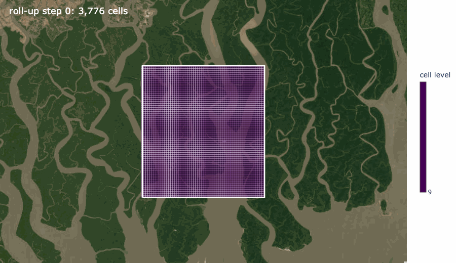
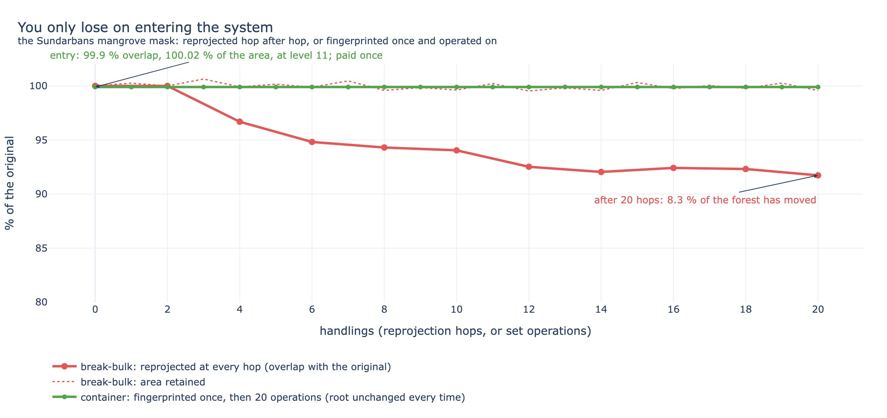
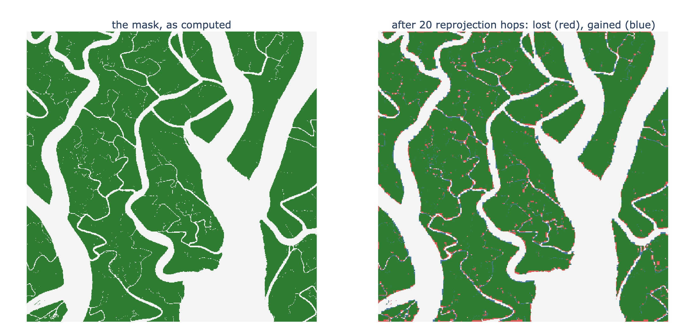
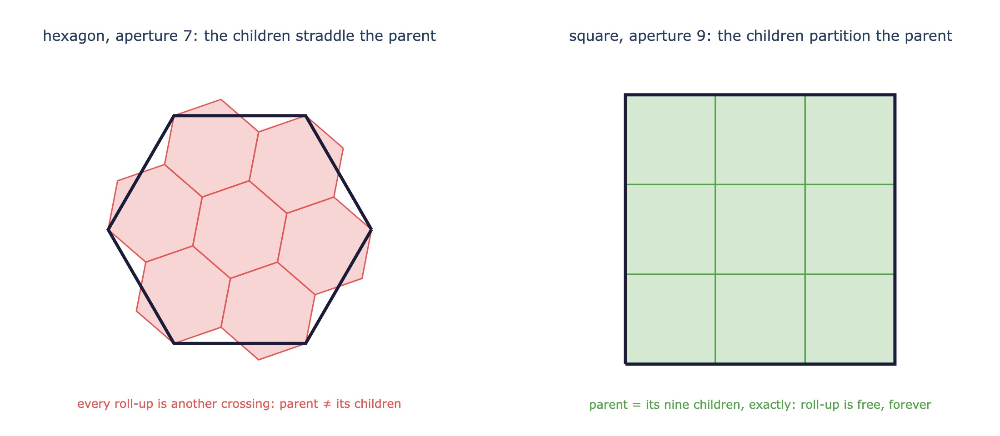

# A fingerprint on every entity

OSPD 2026 records what each activity in a workflow used and generated. This adds one field to
those entities: the identity of the ground they cover.



A **fingerprint** is the SHA-256 root of the compact list of DGGS zones a footprint covers, on
the OGC-registered rHEALPix grid, at a refinement level. Same ground in any file format, one
root. Two runs on two platforms, same root. Zone lists intersect, union and diff with exact
areas, and travel with the entity, so anyone can verify a root from the JSON.

In the mangrove biomass workflow from OSPD 2025, the three entities in the chain each carry one:

| entity | its ground |
|---|---|
| the Sentinel-2 scene | what the satellite covered |
| the analysis output | the pixels the numbers were computed on |
| the mangrove mask | where mangrove was found |

```json
"fingerprint:root":       "433e386d348a20d045cbb0a9663cf4d1958aa1cdb2a69259c49f8e5148405db7",
"fingerprint:dggrs":      "https://www.opengis.net/def/dggrs/OGC/1.0/rHEALPix",
"fingerprint:zone_level": 11,
"fingerprint:zone_count": 174881
```

## Why adopt it: the container

The shipping container did not standardise cargo. It standardised the box, and once every port,
crane and ship agreed on the box, anything could ride inside it and nothing was re-handled at
each stop. Before containers, cargo was break-bulk: unpacked and repacked at every port, and
bruised every time.

Spatial data is still break-bulk. Every step of a workflow and every platform in a chain
reprojects and resamples to its own grid, and each handling moves the pixels a little. Here is
one mangrove mask, the Sundarbans as we computed it, sent through twenty hops of the kind data
really makes: UTM at 30 m, WGS84, Web Mercator at 60 m, a slightly different WGS84 grid, UTM at
50 m, and round again.



After twenty handlings, 8 % of the forest is in the wrong place. Every area total stayed within
half a percent, so a summary table would never notice. A change detector would report 8 % change
that never happened. And the fine creeks that thread the forest are gone from the map.



The container route pays once, at the door. Fingerprinting the same mask on the grid costs a
tenth of a percent of overlap and two hundredths of a percent of area, at level 11. Then twenty
operations, union, intersection, difference, zone-list round trip, roll-up: the root is the same
32 bytes every time and the zone count never changes. Nothing is ever re-handled, because the
system was built so that nothing has to be reopened.

- Every box is the same size, so capacity is a count. Every zone is the same area, so a zone
  count is an area.
- Two twenty-foot boxes fill one forty-foot slot. Nine zones fill their parent, so a whole
  survey area is a short list.
- The container number confirms a box arrived intact without opening it. The root does that for
  ground: rebuild the list, hash it, compare.
- The manifest travels with the box. The zone list travels with the entity.
- Any cargo inside: a COG, a Zarr store, a mask, a scene.

Numbers: `scripts/crossings.py`, on the cached scene, reproducible.

## Why this grid

Not because it distorts least. It does not, and nobody needs it to. Because loss stops at one.
Every move between grids is a crossing, and the first crossing does nearly all the damage
([The Cartographer's Bargain](https://starlingfoundries.com/notes/the-cartographers-bargain)); the
cure is to cross once and never again. For that, the grid must have two properties together:
equal area, so that a count is an area and fractions are fair, and exactly nested children, so
that rolling up is not another crossing.



Hexagonal grids have the first property and not the second. rHEALPix (Gibb, Raichev and Speth,
Manaaki Whenua Landcare Research; OGC API - DGGS Annex B) has both, with a closed-form projection
so that two implementations agree to the bit, and it is already in PROJ and in OGC's reference
library. It is not the prettiest grid. It is the one where everybody gets the same bits, and the
one on which you are never charged twice. The grid is a parameter of the profile; another
equal-area nested grid could be a second profile.

Last year one of our reported figures was computed on 3 % of the survey area, and nothing in the
catalog said so. With the field, that is a number you can read off, and comparing two dates is a
set difference.

**Try it:** [examples/provenance.json](examples/provenance.json) is one run of the workflow as
a provenance chain in the OSPD profile's shape, every entity fingerprinted. One CWL step
appended to any application package writes the field ([cwl/fingerprint.cwl](../cwl/fingerprint.cwl));
the same command at stage-out fingerprints every product on a platform. Extension, schema and
pystac class: [stac-extension/](../stac-extension/). Library: [burin-core](https://github.com/starling-foundries/burin-core), Apache-2.0.

*More: the interactive notebook (`uv run marimo run fingerprints_marimo.py`, thirteen screens), its
[rendered page](fingerprints_demo.html) and [deck](fingerprints_deck.pdf); [USAGE.md](USAGE.md);
[FINDINGS.md](../FINDINGS.md).*
